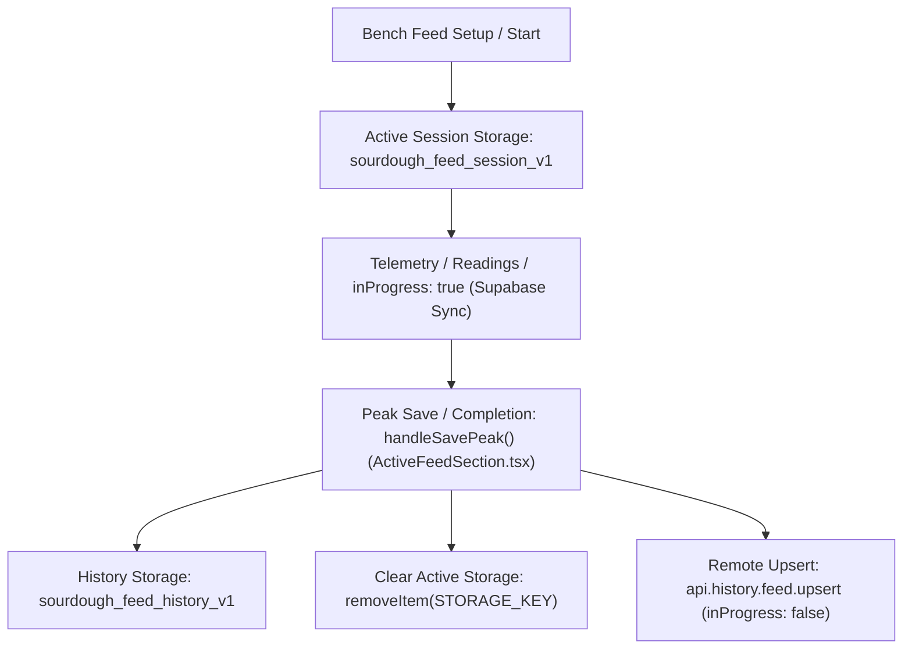
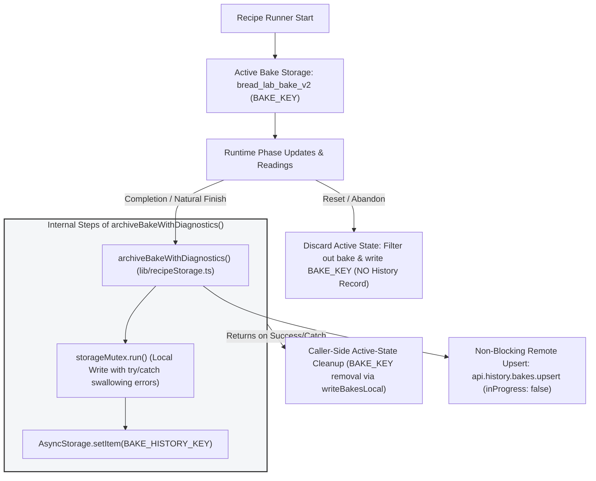

# Architectural Atlas: Phase 3B — Cross-Hub Data-Flow Mapping (Final Verified Sign-Off)

**Branch:** `the-bakers-bench`  
**Scope:** Read-only architectural mapping of data ownership, read/write paths, persistence mechanisms, navigation handoffs, and synchronization boundaries among the active **Lab**, **Bench**, and **Log** hubs in Bread Lab (`artifacts/sourdough/`).

---

## 1. Authoritative Mermaid Diagram: Active Hubs & Route Boundaries
```mermaid
flowchart TD
    subgraph Tabs ["Expo Router Tab Navigation (app/(tabs)/_layout.tsx)"]
        Lab["Lab Hub (lab.tsx)"]
        Bench["Bench Hub (bench.tsx / index.tsx)"]
        Log["Log Hub (log.tsx)"]
    end

    subgraph HiddenRoutes ["Hidden Legacy Routes (href: null)"]
        Recipe["recipe.tsx"]
        History["history.tsx"]
        Graph["graph.tsx"]
    end

    User["Baker / Navigation"] -->|Bottom Tab Tap| Tabs
    User -.->|Deep-Link / Programmatic Push (Unverified)| HiddenRoutes

    Lab -->|router.push({ pathname: '/bench', params: { section: 'feed', ... } })| Bench
    Bench -->|Focus Effect Reloads| Storage[(AsyncStorage & Supabase API)]
    Lab -->|Focus Effect Reloads| Storage
    Log -->|Focus Effect Reloads| Storage

    style HiddenRoutes fill:#f9f9f9,stroke:#666,stroke-width:1px,stroke-dasharray: 5 5
```

---

## 2. Authoritative Mermaid Diagram: Feed Active vs. Completed History Lifecycle


---

## 3. Authoritative Mermaid Diagram: Bake Execution, Reset (#69), & Completion Archival


---

## 4. Cross-Hub Data-Flow & Handoff Matrix (Source-Evidenced)

Every cross-hub data interaction is traced below to its explicit source writer, persistence mechanism, reader, triggering event, and line-level reference.

| Flow / Workflow | Writer (Producer) & Source Reference | Persistence Mechanism & Storage Key | Reader (Consumer) & Source Reference | Triggering Event & Handoff Modality |
| :--- | :--- | :--- | :--- | :--- |
| **Lab Recipe Creation → Bench Execution** | `components/lab/labHub.tsx` (lines 142–165); `CandidateReviewController.tsx` (lines 65–140) | Local AsyncStorage (`bread_lab_recipes_v1`) via `lib/recipeStorage.ts` (lines 223–226) | Bench Hub (`components/bench/benchHub.tsx`) & `RecipePickerModal.tsx` | **Shared Persistence + Focus Reload**: Saved recipes write to local storage; Bench loads them via `loadAll()` inside `useFocusEffect` when focusing Bench. |
| **Lab Feed Advisor → Bench Feed Tracker** | Parent Container: `components/lab/labHub.tsx` (lines 332–346 via `PeakWindowAdvisor.tsx` line 550 `router.push`) | None (Stateless route parameters passed via router URL) | Bench Hub (`benchHub.tsx` → `ActiveFeedSection.tsx`) | **Direct Navigation (Expo Router)**: Parent container `labHub.tsx` calls `router.push({ pathname: '/bench', params: { section: 'feed', starter, flour, water } })`. Consumed via `useLocalSearchParams()`. |
| **Bench Active Bake Execution → Archival to History** | `components/bench/ActiveBakeSection.tsx` & `lib/recipeStorage.ts` (lines 319–365, `archiveBakeWithDiagnostics()`) | Active: `bread_lab_bake_v2` (`BAKE_KEY`)  <br>History: `bread_lab_bake_history_v1` (`BAKE_HISTORY_KEY`) + Supabase API (`api.history.bakes.upsert`) | Log History (`components/log/log.tsx`) & Lab Analytics (`components/lab/labHub.tsx`) | **Shared Persistence + Focus Reload**: Active bakes transition to completed history via `archiveBakeWithDiagnostics()` upon completion; Reset/abandonment discards active state without archiving. Log and Lab hubs reload history via `useFocusEffect`. |
| **Feed Session Completion (Bench) → History & Analytics (Log & Lab)** | `components/bench/ActiveFeedSection.tsx` (lines 235–270, `handleSavePeak()`) | Active: `sourdough_feed_session_v1` (`STORAGE_KEY`)  <br>History: `sourdough_feed_history_v1` (`HISTORY_KEY`) + Supabase API (`api.history.feed.upsert`) | Log History (`components/log/log.tsx`) & Lab Analytics (`components/lab/labHub.tsx`) | **Shared Persistence + Focus Reload**: Completed feed sessions write to history storage (`HISTORY_KEY`); Analytics and Calendar views reload data on focus. |

---

## 5. Detailed History Traces & Persistence Separation

### A. Active-Bake vs. Bake-History Persistence Separation
- **Active-Bake Execution Persistence (`ActiveFeedSection.tsx`, `recipeStorage.ts`)**:
  - **Storage Key**: `bread_lab_bake_v2` (`BAKE_KEY`, `lib/recipeTypes.ts`).
  - **Writer**: `ActiveBakeSection.tsx` writes ongoing active bake state, phase timestamps, and readings during runtime execution.
- **Bake-History Persistence (`lib/recipeStorage.ts`, lines 319–365, `archiveBakeWithDiagnostics()`)**:
  - **Storage Key**: `bread_lab_bake_history_v1` (`BAKE_HISTORY_KEY`).
  - **Writer**: When a bake completes successfully, `archiveBakeWithDiagnostics()` commits the record to `BAKE_HISTORY_KEY`, and callers execute active-state cleanup (`BAKE_KEY` removal). **Note**: Resetting or abandoning an active bake discards active state without creating a history record or submitting anything for diagnostic review.

### B. Active-Feed vs. Feed-History Persistence Separation
- **Active-Feed Session Persistence (`ActiveFeedSection.tsx`, lines 26–33, 105–130)**:
  - **Storage Key**: `sourdough_feed_session_v1` (`STORAGE_KEY`).
  - **Writer**: `ActiveFeedSection.tsx` writes ongoing active telemetry to local AsyncStorage and syncs progress to Supabase (`inProgress: true`).
- **Feed-History Persistence (`ActiveFeedSection.tsx`, lines 235–270, `handleSavePeak()`)**:
  - **Storage Key**: `sourdough_feed_history_v1` (`HISTORY_KEY`).
  - **Writer**: When a feed session completes (`handleSavePeak()`), the session record is prepended to history storage (`HISTORY_KEY`), the active session is cleared (`STORAGE_KEY`), and a completed record (`inProgress: false`) is sent to Supabase.

---

## 6. Route Resolution (`/bench` Mapping)

- **Source Evidence**: 
  - `artifacts/sourdough/app/(tabs)/_layout.tsx` (lines 100–120) declares `<Tabs.Screen name="bench" options={{ title: "Bench", ... }} />`.
  - The file `artifacts/sourdough/app/(tabs)/bench.tsx` exists on this branch.
  - Its actual export is `IndexRoute()`, which renders `<BenchHub />` (`artifacts/sourdough/components/bench/benchHub.tsx`).
- **Navigation Handoff**: `PeakWindowAdvisor.tsx` delegates navigation via prop `onApplyRecipe`, which is instantiated by its parent container `components/lab/labHub.tsx` (lines 332–346 & line 550) invoking `router.push({ pathname: "/bench", params: { section: "feed", starter, flour, water, autoStart: "false" } })`. This resolves directly to `app/(tabs)/bench.tsx`.

---

## 7. Update Mechanisms: State Reevaluation (Polling vs. Reactive)

- **Investigation Question**: What propagation mechanisms drive inter-hub state synchronization?
- **Source-Evidenced Findings**: 
  - `useFocusEffect` hooks (`labHub.tsx` line 105, `log.tsx` line 145) trigger asynchronous data reloads (`loadData()`, `loadHistory()`) whenever a screen gains focus.
  - **Architectural Interpretation**: Focus reloads are a documented mechanism that ensures data freshness upon returning to a tab.
  - **Real-Time Claims**: No WebSocket subscriptions were found in the inspected inter-hub paths.

---

## 8. Classification Ledger

| Claim / Mechanism | Classification | Source Evidence & Reference |
| :--- | :--- | :--- |
| **Active bakes use `bread_lab_bake_v2` (`BAKE_KEY`), while completed bakes use `bread_lab_bake_history_v1` (`BAKE_HISTORY_KEY`)**. | **Source-Confirmed** | `artifacts/sourdough/lib/recipeStorage.ts` (`BAKE_KEY` vs `BAKE_HISTORY_KEY`, `archiveBakeWithDiagnostics()`). |
| **Reset/abandonment discards active bakes without archiving**. | **Source-Confirmed** | `ActiveFeedSection.tsx` / `ActiveBakeSection.tsx` (`handleAbandonBake()`), `recipe.tsx` (`resetBake()`). |
| **Legacy routes are hidden via `href: null`, and deep-link reachability is unverified**. | **Source-Confirmed (Hidden) / Unverified (Deep-links)** | `app/(tabs)/_layout.tsx` (lines 180–190). |
| **Active-feed persistence uses `sourdough_feed_session_v1`, while history uses `sourdough_feed_history_v1` via `handleSavePeak()`**. | **Source-Confirmed** | `artifacts/sourdough/components/bench/ActiveFeedSection.tsx` (lines 26–29 (`STORAGE_KEY` vs `HISTORY_KEY`), lines 235–270 (`handleSavePeak()`)). |
| **Inter-hub state updates propagate in real time via live WebSocket event subscriptions**. | **Not Found** | Zero WebSocket subscriptions for inter-hub state were found in the inspected inter-hub paths. |

---

## 9. High-Value Future Runtime Checks & Unresolved Contracts

1. **Focus Reload Latency**: Verify whether rapid tab switching between Lab, Bench, and Log causes any perceptible frame drop or layout jank during asynchronous AsyncStorage parsing (`loadAll()`, `loadHistory()`).
2. **Concurrent Mutation Consistency**: Verify behavior if a recipe is edited in Lab while simultaneously selected for a run in Bench (Issue #78).
3. **Parked Issue #73 Toast-Duration Test**: Recorded as unresolved pending physical device observation (per user instruction, not investigated further).
