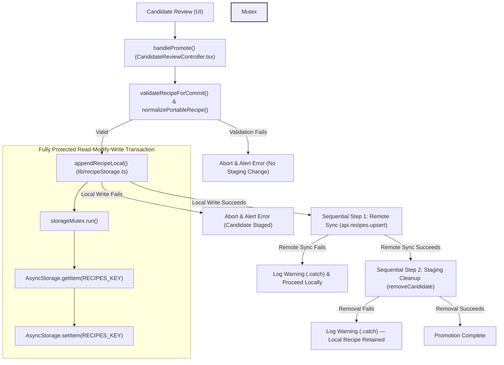

# Architectural Atlas: Phase 2 — Runtime Data-Flow Map (Recipe Builder & Candidate Review)

**Branch:** `the-bakers-bench`  
**Scope:** Read-only source-evidence verification of candidate promotion failure semantics, persistence abstraction differences, candidate draft serialization, and authoritative Mermaid data-flow diagrams in Bread Lab (`artifacts/sourdough/` ).

---

## 1. Candidate Promotion Failure Semantics & Failure Paths

Source tracing of `handlePromote()` in `components/recipe/CandidateReviewController.tsx` reveals the exact error handling and execution flow during candidate promotion:

1. **Validation & Normalization (Synchronous)**:
   - `validateRecipeForCommit(portableRecipe)` is executed. If validation fails, it throws an error which aborts promotion and triggers the try/catch alert in `BakerReviewModal.tsx`.
   - `normalizePortableRecipe()` runs next.
2. **Local Commit (Async)**:
   - Reads `RECIPES_KEY` (`bread_lab_recipes_v1`) via `AsyncStorage.getItem()`, parses with `safeParse()`, unshifts the new `SavedRecipe`, and writes back via `AsyncStorage.setItem()`.
   - **Failure Behavior**: If local AsyncStorage write fails, the promise rejects, catching in `BakerReviewModal.tsx` (`Alert.alert('Promotion Error', ...)`). The candidate remains intact in staging storage because `removeCandidate()` has not yet been called.
3. **Remote Synchronization (Async - Non-Blocking for Local Success)**:
   - If `userId` is present, `api.recipes.upsert(normalizedPayload)` is executed.
   - **Failure Behavior**: If remote sync fails, `.catch(...)` catches the error and logs a warning: `[CandidateReviewController] Remote sync failed, saved locally: ...`. **Crucially**, local-commit success is preserved and promotion proceeds. Remote sync failure does **not** roll back local persistence.
4. **Candidate Removal (Async)**:
   - `removeCandidate(candidateId)` is called to purge the candidate from staging storage (`candidateStorage.ts`).
   - **Failure Behavior**: If candidate removal fails, the recipe is successfully committed locally, but the candidate record could theoretically remain in staging storage (leading to duplication if retried).
5. **Atomicity Note**: Promotion is **not atomic**. Local recipe write, remote sync, and candidate removal occur in sequential asynchronous steps with separate try/catch boundaries.

---

## 2. Authoritative Mermaid Diagram: Recipe Promotion Pipeline & Failure Paths (Issue #78)



---

## 3. Authoritative Mermaid Diagram: Candidate Draft Save / Restore / Discard Lifecycle

```mermaid
flowchart TD
    A["Baker Edits Draft in BakerReviewModal"] -->|Modal-Local State| B["stagedRecipe (React State)"]
    B -->|Save Changes / Switch Subcard| C["CandidateReviewControllerRef.saveChanges()"]
    C --> D["updateCandidateExtraction() (candidateStorage.ts)"]
    
    subgraph Mutex Protected Draft ["storageMutex Protected Staging Write"]
        D --> D1["storageMutex.run()"]
        D1 --> D2["AsyncStorage.getItem(CANDIDATES_KEY)"]
        D2 --> D3["AsyncStorage.setItem(CANDIDATES_KEY)"]
    end
    
    D -->|Persisted State in AsyncStorage| E["Persisted Candidate Record (bread_lab_candidates_v1)"]
    E -->|Reopen Candidate from Candidates Subcard (LabHub.tsx)| F["loadCandidates() reads persisted state"]
    F --> G["BakerReviewModal useEffect restores stagedRecipe"]
    
    B -->|Discard Candidate| H["removeCandidate(candidateId) permanently deletes record"]

    style Mutex Protected Draft fill:#f4f6f8,stroke:#333,stroke-width:2px
```

---

## 4. Candidate Draft Round-Trip Serialization & Lifecycles

Source tracing of `BakerReviewModal.tsx` and `candidateStorage.ts` establishes how draft edits are serialized, deferred, and restored:

1. **Modal-Local Draft State**:
   - While editing within `BakerReviewModal.tsx`, all modifications to recipe name, overview, yield, and phase assignments are held in component-local React state (`stagedRecipe: PortableRecipe | null`).
2. **Defer / Save & Close ("Save Changes")**:
   - When the baker taps "Save & Close" (or switches builder subcards while editing), `CandidateReviewControllerRef.saveChanges()` invokes `handleSaveAndClose()`.
   - This builds an updated `ExtractionResult` via `buildUpdatedExtractionResult()`, capturing the current `stagedRecipe` state.
   - It calls `updateCandidateExtraction(candidateId, updatedExtractionResult)` in `lib/candidateStorage.ts`.
   - `updateCandidateExtraction()` acquires `storageMutex`, reads the candidate record list, updates the target candidate's `extractionResult`, and writes back to AsyncStorage via `AsyncStorage.setItem()`.
3. **Persisted Candidate State & Restoration**:
   - Between `updateCandidateExtraction()` and `loadCandidates()`, draft extractions reside in persistent local storage under `bread_lab_candidates_v1` (`CANDIDATES_KEY`).
   - When the baker subsequently reopens the candidate from the **Candidates** subcard (`LabHub.tsx`), `loadCandidates()` reads the stored `CandidateRecord` from AsyncStorage.
   - `BakerReviewModal`'s `useEffect` seeds `stagedRecipe` from `candidates[idx].extractionResult`, fully restoring all deferred draft edits, custom phase assignments, and line modifications.
4. **Discard**:
   - Tapping "Discard Candidate" invokes `removeCandidate(candidateId)`, permanently deleting the candidate record and discarding all modal-local and persisted draft edits.

---

## 5. Persistence Abstraction & Mutex Boundaries (Issue #78)

A significant architectural comparison exists between ordinary recipe saving and candidate promotion persistence regarding mutex protection:

| Operation | Implementation File & Function | Persistence Abstraction & Mutex | Concurrency Guarantee |
| :--- | :--- | :--- | :--- |
| **Ordinary Recipe Save** | `lib/recipeStorage.ts`<br>`writeRecipesLocal()` | Uses `storageMutex.run(...)` wrapping only `AsyncStorage.setItem()` | **Partial**: Initial reads and data derivations occur outside any lock; only final write is mutex-protected. (Issue #78) |
| **Candidate Promotion** | `lib/recipeStorage.ts`<br>`appendRecipeLocal()` | Uses `storageMutex.run(...)` wrapping both `AsyncStorage.getItem()` and `AsyncStorage.setItem()` | **Fully Protected**: Complete read-modify-write transaction is locked and serialized under `storageMutex`. |
